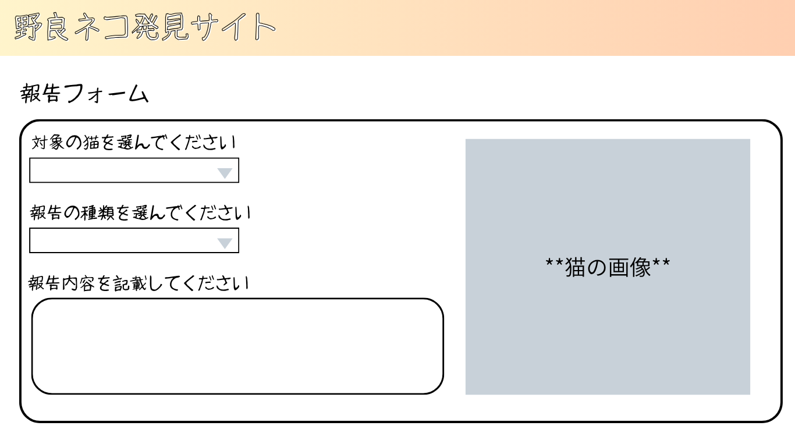
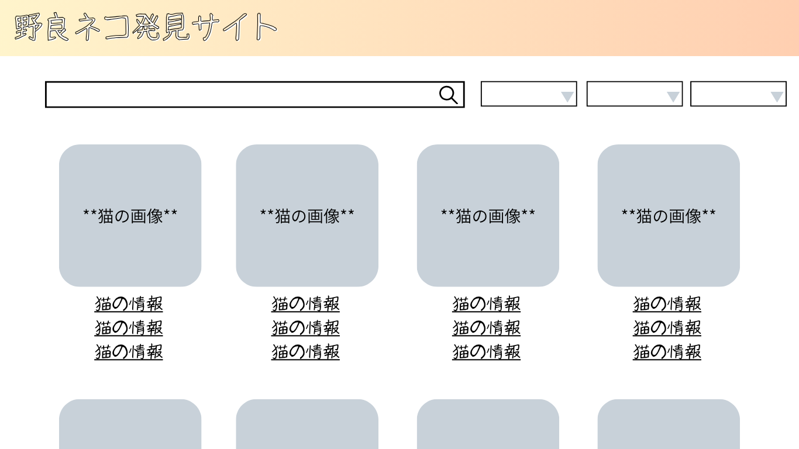
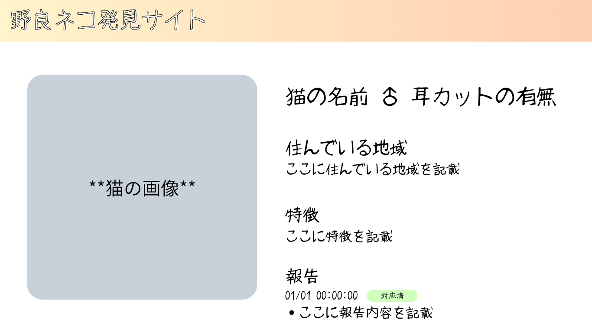
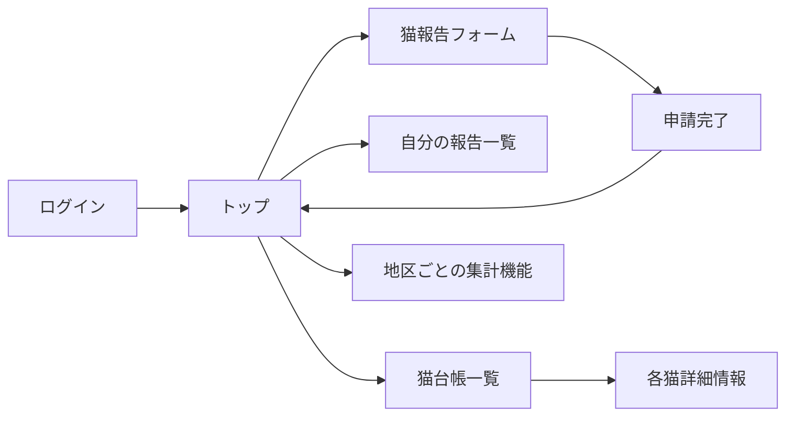
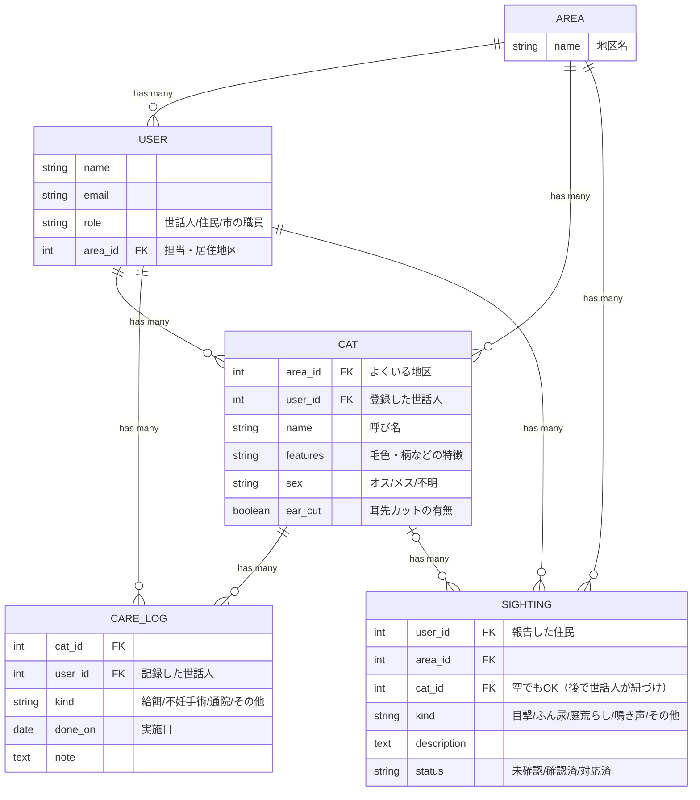

# 基本設計書：欠勤連絡アプリ

- チーム番号：チーム06

## 課題
- **選んだ課題**：
  - 東大阪市では野良猫の不妊手術に助成金を出し、累計3,649匹（令和7年度まで）の手術を支援してきたが、手術後の猫がどこに何匹いて、誰が世話をし、どんな被害が出ているかを把握する仕組みがない。そのため、助成金の効果も測れず、猫をめぐる住民トラブルも一定数残っている。
- **誰の課題か**：
  - 東大阪市〇〇町で野良猫の世話をしているボランティアの中村さん（60代）。近所の猫10匹ほどにエサやりや手術の手配をしているが、どの猫が手術済みかは自分のノートと記憶だけで管理している。近所から「また猫が増えた」「庭にふんをされた」と言われても、どの猫のことか分からず説明できない。
  - 東大阪市動物指導センターの職員・森さん。耳先カット（不妊手術済みの印）の猫を見かけることは増えたが、市内に手術済みの猫が何匹いて、被害が減っているのかを数字で示せない。
- **なぜこの課題を選んだか**：自治体が「実態を把握する現実的な方法がない」と明言している課題であり、猫1匹ずつの記録・世話の履歴・被害報告をつなげて地区ごとに集計することは、紙やLINEではできず、データベースを使うシステムでこそ解決できると考えたから。
- **元になった自治体課題**：[大阪府 東大阪市 市内に生息する野良猫の生態や飼養管理、被害状況の把握に向けて](https://www.park.itc.u-tokyo.ac.jp/padit/cog2026/area/kinki.html#kusatsu-list)

## 0. 考えを整理する3つの問い
 **開発目的**：野良猫1匹ずつの情報（耳先カットの有無・世話の記録）と住民からの被害報告を1か所に集め、地区ごとの登録猫数・耳先カット率・被害報告件数を集計できるようにする。これにより、市が手術の進み具合や被害の多い地区を把握し、助成金の効果を考える手がかりにする。また、被害報告が世話をしている人に届き、対応状況が見えることで、住民と世話人のトラブルを減らす。
- **想定ユーザ**：
  - 世話人（地域で野良猫の世話をしているボランティア）
  - 住民（猫の被害に困っている人、猫を見かけた人）
  - 市の職員（動物指導センター）
- **機能**：
  - 住人用画面と市の職員用画面を分離する
  - 猫の台帳登録機能（写真・特徴・地区・耳先カットの有無）
  - 世話の記録機能（給餌・不妊手術・通院）
  - 目撃・被害の報告機能
  - 自分が報告した猫一覧を見れる機能
  - 被害報告への対応状況の更新機能
  - 地区ごとの集計機能（猫の数・耳先カット率・被害件数）

## 1. ユーザーストーリー
- ストーリー1：【世話人】として、手術済みかどうかを忘れないよう、地区の猫を写真・毛色などの特徴・耳先カットの有無とともに1匹ずつ登録したい。
- ストーリー2：【世話人】として、世話の状況を他の世話人とも共有するため、猫ごとに給餌・不妊手術・通院の記録を残したい。
- ストーリー3：【世話人】として、住民の苦情にきちんと応えるため、自分の地区の被害報告を一覧で確認し、どの猫のことかを紐づけて、対応状況（未確認／確認済／対応済）を更新したい。
- ストーリー4：【住民】として、困っていることを世話人や市に伝えるため、猫の目撃やふん尿・庭荒らし・鳴き声などの被害を、地区と写真を添えて報告したい。
- ストーリー5：【市の職員】として、助成金の効果を説明するため、地区ごとの猫の数・耳先カット率・被害報告件数を一覧で見たい。

## 2. 画面イメージ（ワイヤーフレーム）

## 3. ページ遷移図

## 4. データモデル（ER図）

- 猫と報告の写真は Active Storage で添付する（`Cat has_one_attached :photo`、`Sighting has_one_attached :photo`）。
- 関連はすべて１：多。外部キー（`〇〇_id`）を持つ側が参照元。
  - `Area has_many :users, :cats, :sightings`
  - `User has_many :cats, :care_logs, :sightings`
  - `Cat has_many :care_logs, :sightings`
  - `CareLog belongs_to :cat, :user`
  - `Sighting belongs_to :user, :area` / `belongs_to :cat, optional: true`
- 地区ごとの集計（猫の数・耳先カット率・被害件数）は専用のテーブルを作らず、Cat と Sighting を地区ごとに数えて表示する。

## 5. 開発着手の許可基準に対する自己チェック
- [x] 課題の具体性：身近な実在のペインに基づいているか？
- [x] 連動性：ユーザーストーリーと画面・データモデルが破綻なく繋がっているか？
- [x] ボリュームの妥当性：第14回までに2名で作りきれる規模感か？
